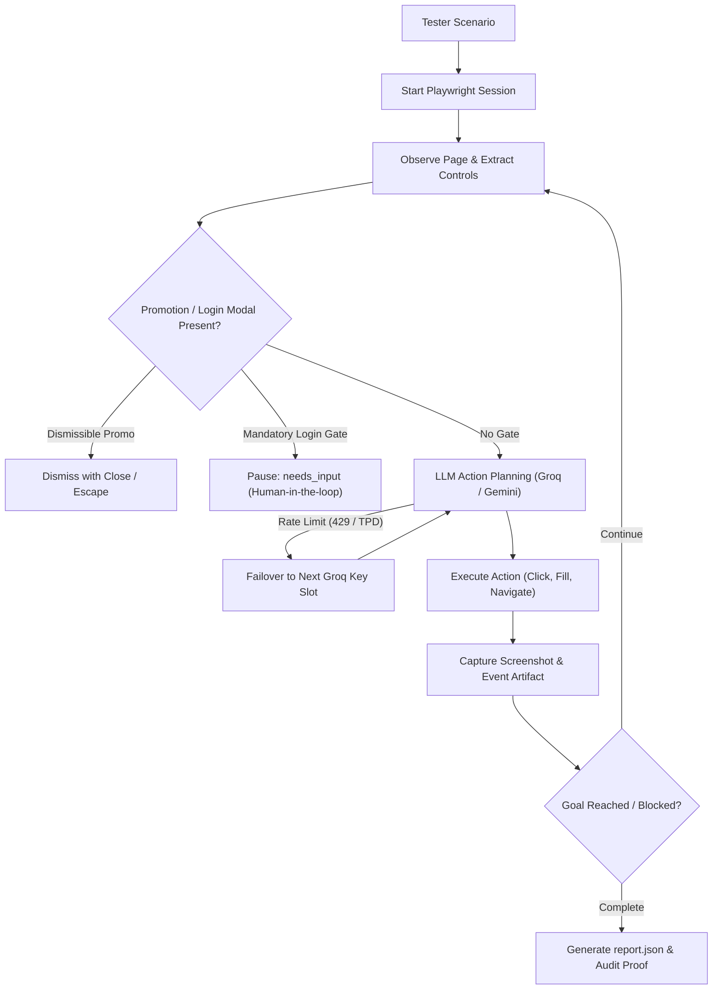

<div align="center">
  
# 🚀 PerfSight AI 
**Autonomous Performance & Browser QA Intelligence Platform**

*Enterprise-grade AI-powered performance testing and autonomous scenario-driven browser QA — From plain English to actionable insights in minutes.*

[](https://fastapi.tiangolo.com/)
[](https://react.dev/)
[](https://www.typescriptlang.org/)
[](https://playwright.dev/)
[](https://groq.com/)
[](https://cloud.google.com/vertex-ai)

**Multi-Account Key Failover | Frame-Aware Login Gating | Real Browser Automation | 10+ LLM Providers**

</div>

---

## 📋 Table of Contents

- [Overview](#-overview)
- [Key Capabilities](#-key-capabilities)
- [Autonomous Browser AI QA Agent](#-autonomous-browser-ai-qa-agent)
- [Architecture](#-architecture)
- [Local Setup & Quick Start](#-local-setup--quick-start)
- [How to Run Tests Locally](#-how-to-run-tests-locally)
- [LLM Provider Support & Key Failover](#-llm-provider-support--key-failover)
- [API Reference](#-api-reference)
- [Tech Stack](#-tech-stack)

---

## 💡 Overview

**PerfSight AI** unites enterprise performance engineering with autonomous end-to-end browser QA testing. Driven by LLMs and headless browser automation, it handles two core dimensions of quality assurance:

1. **Autonomous Browser AI QA Agent**: Explores live web applications, verifies workflows and promotion codes (e.g., GrabOn to retailer sites like Levi's, H&M), inspects product/cart flows, handles dynamic modal dialogs, and detects login gates with secure human-in-the-loop pauses.
2. **Performance Intelligence Pipeline**: Translates natural language requirements into runnable k6 and JMeter load scripts, correlates dynamic parameters, detects anomalies with machine learning, and produces root-cause diagnostics.

---

## ✨ Key Capabilities

| Capability | What It Does |
|---|---|
| **Autonomous Web Exploration** | Launches Playwright Chromium to navigate complex UI flows, execute search, add items to cart, and test promo codes. |
| **Multi-Account Key Failover** | Seamlessly rotates through up to 3 Groq API key slots when token-per-day (TPD) or rate limits (HTTP 429) hit. |
| **Frame-Aware Login Gating** | Recursively scans parent and iframe trees to detect phone/login prompts (e.g. GoKwik KwikPass, Shopify drawers) and safely pauses for tester input (`needs_input`). |
| **Social Redirect Recovery** | Filters unlabeled mystery links and automatically bounces back if a redirect lands on messaging channels (Telegram, WhatsApp). |
| **Natural Language to Load Script** | Translates plain English scenarios into fully executable k6 or Apache JMeter scripts. |
| **Auto-Correlation Engine** | Identifies dynamic session tokens, CSRF tokens, and IDs in JMX/HAR files and injects regex extractors automatically. |
| **ML Anomaly Detection** | Flags latency spikes, error bursts, and throughput degradation using Isolation Forests and KPI thresholding. |

---

## 🌐 Autonomous Browser AI QA Agent

The Browser QA Agent (`backend/browser_agent.py`) executes scenario-driven web journeys with full visual audit trails:



### Safety & Guardrails Built-In:
- **Zero Accidental Purchases**: Actions containing keywords like *place order*, *pay now*, *submit payment*, or *accept terms* are blocked by default.
- **Privacy First**: Passwords, OTPs, telephone numbers, and payment details are scrubbed from screenshots, logs, and report payloads.
- **Resilient Execution**: Automatically skips duplicate offers and recovers if external retailers return HTTP 403 / Access Denied.

---

## 🏗️ Architecture

```text
PerfSight-AI/
├── backend/
│   ├── agents/
│   │   ├── llm_router.py          # Unified router with Groq 3-key rotation & multi-provider support
│   │   ├── nl_scenario_parser.py  # Natural language scenario parser
│   │   ├── script_gen_agent.py    # k6 / JMeter load test generator
│   │   └── analysis_agent.py      # KPI & anomaly analyzer
│   ├── browser_agent.py           # Autonomous Playwright Browser AI QA Agent
│   ├── browser_qa.py              # Health-check & screenshot runner
│   ├── executors/                 # k6 and JMeter runner engines
│   ├── ml/                        # ML anomaly detection & correlation
│   └── main.py                    # FastAPI server exposing REST & Static artifacts
├── frontend/
│   ├── src/
│   │   ├── components/
│   │   │   ├── AIQAPanel.tsx      # Autonomous Browser QA UI & live screenshot viewer
│   │   │   ├── ToolsPanel.tsx     # Tools hub (AI QA, Correlator, Traffic)
│   │   │   └── SettingsDrawer.tsx # Multi-provider model & key configuration
│   │   └── api.ts                 # Typed backend client
└── perfsight.db                   # Local SQLite test runs database
```

---

## 🚀 Local Setup & Quick Start

### 1. Prerequisites
- **Python**: 3.10+ installed
- **Node.js**: 18+ and `npm` installed
- **Browser Engine**: Playwright Chromium
- **Git**

### 2. Clone Repository
```bash
git clone https://github.com/Pasha2308/PerfSight-AI.git
cd PerfSight-AI
```

### 3. Backend Setup
1. Create and activate a Python virtual environment:
   ```bash
   # Windows (PowerShell)
   python -m venv .venv
   .venv\Scripts\Activate.ps1

   # Linux / macOS
   python3 -m venv .venv
   source .venv/bin/activate
   ```

2. Install backend dependencies and Playwright browser:
   ```bash
   cd backend
   pip install -r requirements.txt
   playwright install chromium
   ```

3. Configure Environment Variables:
   Copy `.env.example` to `backend/.env` (or root `.env`):
   ```bash
   cp .env.example .env
   ```
   Add your primary Groq API key (and optionally backup keys for automatic failover):
   ```env
   GROQ_API_KEY=gsk_your_primary_key_here
   GROQ_API_KEY_2=gsk_your_second_backup_key_here
   GROQ_API_KEY_3=gsk_your_third_backup_key_here
   GROQ_MODEL_FAST=openai/gpt-oss-20b
   ```

4. Start the FastAPI Backend:
   ```bash
   uvicorn main:app --reload --port 8000
   ```
   The API will be live at `http://127.0.0.1:8000` (docs at `http://127.0.0.1:8000/docs`).

### 4. Frontend Setup
In a new terminal window:
```bash
cd frontend
npm install
npm run dev
```
Open your browser at `http://localhost:5173`.

---

## 🧪 How to Run Tests Locally

### Option A: Via the Web UI (Visual Interactive Mode)
1. Open `http://localhost:5173` in your browser.
2. In the sidebar, navigate to **Tools** → **AI QA Agent**.
3. In the scenario box, enter your test prompt, for example:
   > *Open this GrabOn offer detail https://www.grabon.in/coupon-codes/236192/ Follow its Levi’s retailer link and inspect the product/cart flow. If a login/signup or mobile-number prompt appears, pause and ask the tester for the required sign-in input. Do not enter personal information or OTPs automatically; do not order or pay. Capture screenshots and report exactly what is verified.*
4. Select provider **Groq** (or your preferred LLM) and click **Start AI QA Run**.
5. Watch live progress: the agent streams step-by-step actions, screenshots, and key failovers in real time. If a login prompt is encountered, enter the requested input in the UI to resume.

---

### Option B: Via Python Script (Headless Automated Execution)
You can trigger an automated test directly using Python without starting the frontend:

```python
import sys
import time
from pathlib import Path

# Add backend directory to path
sys.path.insert(0, "./backend")
from browser_agent import start_run, get_run

scenario = (
    "Open this GrabOn offer detail https://www.grabon.in/coupon-codes/236192/ "
    "Follow its Levi’s retailer link and inspect the product/cart flow. "
    "If a login/signup or mobile-number prompt appears, pause and ask the tester for the required sign-in input. "
    "Do not enter personal information or OTPs automatically; do not order or pay. "
    "Capture screenshots and report exactly what is verified."
)

# Start run with 3-key Groq rotation
run_meta = start_run(
    scenario=scenario,
    provider="groq",
    api_key="", # Automatically picks up GROQ_API_KEY, GROQ_API_KEY_2, GROQ_API_KEY_3
    model="openai/gpt-oss-20b"
)

run_id = run_meta["run_id"]
print(f"Test Run started: {run_id}")

while True:
    report = get_run(run_id)
    status = report.get("status")
    print(f"Status: {status} | Events recorded: {len(report.get('events', []))}")
    if status in {"completed", "failed", "needs_input", "input_timeout"}:
        print("Final Result / Input Request:", report.get("result") or report.get("input_request"))
        break
    time.sleep(3)
```

Saved artifacts and screenshots will be available in:
```text
backend/artifacts/ai-qa/<run-id>/
├── report.json
├── step-000.png
├── step-001.png
└── ...
```

---

## 🤖 LLM Provider Support & Key Failover

PerfSight AI features a unified Multi-LLM Router (`backend/agents/llm_router.py`) supporting:

| Provider | Model ID | Capabilities | Failover Support |
|---|---|---|---|
| **Groq** *(Recommended for QA)* | `openai/gpt-oss-20b`, `llama-3.3-70b-versatile` | Ultra-fast inference | **3-Key Automatic Rotation** |
| **Google Gemini** | `gemini-2.5-flash`, `gemini-2.5-pro` | Multimodal & reasoning | Supported |
| **OpenAI** | `gpt-4o`, `gpt-4o-mini` | High accuracy | Supported |
| **Anthropic** | `claude-3.5-sonnet` | Complex logic | Supported |
| **Ollama** | Local models (e.g. `llama3`) | Completely free & local | Supported |

### Multi-Account Groq Key Rotation
To avoid hitches during long QA workflows, populate the following in your environment:
```env
GROQ_API_KEY=gsk_key_account_1
GROQ_API_KEY_2=gsk_key_account_2
GROQ_API_KEY_3=gsk_key_account_3
```
If Account 1 encounters a rate limit (HTTP 429) or token exhaustion, the planner immediately falls back to Account 2, then Account 3, logging the event in the audit trail without disrupting test execution.

---

## 📡 API Reference

- `POST /api/ai-qa/runs`: Start an autonomous browser QA run with a given scenario.
- `GET /api/ai-qa/runs/{run_id}`: Fetch live status, step history, and screenshot links.
- `POST /api/ai-qa/runs/{run_id}/resume`: Resume a run that paused for tester input (`needs_input`).
- `GET /api/ai-qa/artifacts/{run_id}/{image_name}`: Serve recorded screenshot proof images.
- `POST /api/tests/start-nl`: Trigger end-to-end load testing from a natural language prompt.
- `POST /api/tools/correlate-jmx`: Auto-correlate dynamic parameters in JMeter JMX scripts.

---

## 🛠️ Tech Stack

- **Backend:** FastAPI, Python 3.11, Playwright, HTTPX, Pydantic, SQLite
- **Frontend:** React 18, TypeScript, Vite, TailwindCSS, Monaco Editor, Lucide Icons
- **Engines:** k6, Apache JMeter, Playwright Chromium
- **Intelligence:** Groq (GPT-OSS-20B), Google Gemini 2.5, OpenAI, Anthropic

---

## 📄 License
MIT License. Built for autonomous testing and performance intelligence.
